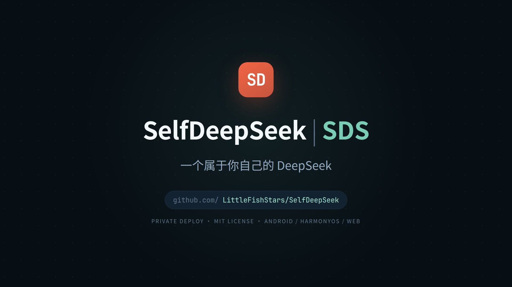

# SelfDeepSeek | SDS

**DeepSeek App 的私有化部署。** 起因是额度不够用 —— 于是自己搭了一套：一套自研后端
代理官方 API、把对话落库、支持离线补发 / 附件 / 搜索 / 跨会话记忆；
客户端是安卓、鸿蒙原生壳和同一套网页端。在此之上还加了几个官方没有、但平时会用到的功能。

**A private deployment of the DeepSeek app.** Built because the quota ran out:
a Go backend proxies the official API and owns your conversation history, with native
Android & HarmonyOS shells plus a plain web client — plus a few extras the official app
doesn't have.

> **与 DeepSeek 官方无关**：本仓库只代理官方公开 API，不包含官方客户端代码，
> 也不代表 DeepSeek 官方立场。前端静态资源来自上游 MIT 项目
> [chat-demo](https://github.com/deepseek-ai/chat-demo) 的构建产物。

---

<p align="center">
  
</p>

<p align="center">
  <b>60 秒看完 SelfDeepSeek</b>
</p>

<p align="center">
  <a href="docs/media/sds-promo.mp4">
    
  </a>
</p>

把 [chat-demo](https://github.com/deepseek-ai/chat-demo) 装进自己的服务器：
一套自研后端负责代理上游 API、把对话落库、离线补发、附件、搜索与跨会话记忆；
客户端是安卓 / 鸿蒙的原生壳（WebView / ArkWeb）和同一套网页端。

## 为什么要自己做

官方 App 的额度不够用，所以先做了个能替代的：把前端接上自己的后端，
Key 放服务端、对话落自己的库。跑起来之后又顺手加了几个官方没有、但确实会用到的功能：

- **断线也照跑** —— 生成在服务端独立进行，杀掉 App / 地铁没信号都不影响，回来自动续播
- **完整过程落库** —— 思考、联网搜索、工具调用的中间步骤全存，换设备还原的是一整段过程
- **跨会话记忆** —— 用户画像 + 上一次对话摘要自动注入新会话，另有 `history_search` 按关键词检索
- **沙箱算数** —— `run_rhai` 在隔离的 Rust 进程里跑脚本，无文件 / 网络 / 进程权限，超时即杀
- **会话分享** —— 任意对话一键生成公开静态页，不用登录就能读
- **自带后台** —— 用户、token 消耗、会话内容、画像，页面里直接看

## 它和「直接用官方 App」差在哪

| 能力 | 说明 |
| --- | --- |
| **Key 只在服务端** | 客户端不持有 API Key，多设备共用一个服务端 Key |
| **服务端维护全部对话** | 客户端只拉不推；换设备、清 App 数据都不丢记录，支持 ZIP 导入历史 |
| **生成与连接解耦** | 提交后服务端在独立 context 里跑上游，客户端断网/杀进程都不影响生成；重连自动续播 |
| **完整过程落库** | 思考、联网搜索、工具调用的中间步骤都存进库，跨端还原完整过程 |
| **停不下来的长对话** | 撞上下文上限前自动折叠成摘要（原文仍留在库里），长回答默认 8192 token 不截断 |
| **跨会话记忆** | 用户画像 + 上一段对话摘要自动注入新会话，另有 `history_search` 工具按关键词检索历史 |
| **沙箱算数** | `run_rhai` 工具在隔离的 Rust 进程里跑脚本（无文件/网络/进程权限，超时即杀） |
| **分享页** | 任意会话可生成公开静态页（服务端直接渲染 HTML，无需登录即可阅读） |
| **账号体系** | 邮箱 + 密码（bcrypt）自建，或对接任何 OIDC 身份提供方（TinyAuth 等） |

## 架构

```
┌──────────────────┐   ┌──────────────────┐   ┌──────────────────┐
│  安卓壳 (Java)   │   │  鸿蒙壳 (ArkTS)  │   │   网页端 (静态)  │
│ WebView + 内置   │   │ Web 组件 + 拦截  │   │   浏览器直开     │
│ 127.0.0.1 静态服 │   │ rawfile 喂 https │   │                  │
└────────┬─────────┘   └────────┬─────────┘   └────────┬─────────┘
         └──────────────────────┼──────────────────────┘
                                │  /chat/*   /auth/*
                       ┌────────▼─────────┐
                       │    nginx         │  剥前缀 + SSE 不缓冲
                       └────────┬─────────┘
                       ┌────────▼─────────┐        ┌───────────────┐
                       │  chat-server     │───────▶│ DeepSeek API  │
                       │  (Go + SQLite)   │        └───────────────┘
                       │  · SSE 流式任务  │        ┌───────────────┐
                       │  · 消息树落库    │───────▶│ rhai-runner   │
                       │  · 画像 / 搜索   │        │ (Rust 沙箱)   │
                       │  · 后台 / 分享页 │        └───────────────┘
                       └──────────────────┘
```

- 后端是**唯一**的对话入口：客户端只发一条 `POST /chat/anthropic/v1/messages`，
  服务端建任务、跑上游、把 SSE 转回客户端，同时解析落到 SQLite。
- 客户端断开不影响生成：没人完整收下的回复进入 `reply_cache`，
  客户端重连时由 `/chat/v1/cache` 补发。
- 对话存成**消息树**（`parent_id` + `active_leaf`），所以「编辑消息重发」「重新生成」
  能像官方那样产生多个版本，旧版本一条不丢。

## 目录

```
server/
  chat-server/      Go 后端（唯一后端；admin.html 用 go:embed 编进二进制）
  rhai-runner/      Rhai 沙箱执行器（Rust，被 chat-server 按需拉起）
  auth/ mail/       可选：第三方的 TinyAuth / PMail 部署说明（二进制需自行获取）
client/
  android/          安卓壳（Java）+ 打包脚本，产物 dist/sds-<ver>.apk
  harmony/          鸿蒙工程（ArkTS），用 DevEco / hvigor 构建 .hap
deploy/             nginx 与 systemd 模板
docs/               部署、配置、接口、架构、客户端文档
tools/              改 API 域名、生成更新清单的脚本
```

## 快速开始

### 1. 起后端（最小可跑）

```bash
cd server/chat-server
cp ../../.env.example .env      # 填 DS_API_KEY=sk-...
set -a && . ./.env && set +a
go build -trimpath -ldflags="-s -w" -o chat-server .
CHAT_BIND=127.0.0.1 CHAT_PORT=8083 CHAT_DB="$PWD/chat.db" ./chat-server
curl -s localhost:8083/health   # {"ok":true,...}
```

此时对话接口已经可用（`/chat/anthropic/v1/messages`），账号、邮件、OIDC 都是可选项。

### 2. 起前端（网页端）

`client/android/app/assets/` 就是那套静态前端，直接丢给任意静态服务器即可，
接口地址在构建客户端时统一指定（见下）。

### 3. 打一个自己的安卓包

```bash
cd client/android
bash build.sh --api-origin https://你的后端域名     # 会把前端里的接口地址改掉
# → dist/sds-1.0.0.apk
```

依赖（apktool/android.jar/r8/uber-apk-signer）脚本会自动下载，
签名用脚本自建的自签名密钥库，直接侧载安装即可。

鸿蒙侧见 [docs/clients.md](docs/clients.md)，需要 DevEco SDK 与华为签发的证书才能装真机。

### 4. 上生产

详见 [docs/deploy.md](docs/deploy.md)：certbot 证书、nginx 两站点、systemd 常驻、
可选的 OIDC 登录与自建收件服务器，以及后台管理页。

## 文档

| 文档 | 内容 |
| --- | --- |
| [docs/deploy.md](docs/deploy.md) | 从零部署：编译、systemd、nginx、证书、账号体系、后台 |
| [docs/configuration.md](docs/configuration.md) | 全部 40 个环境变量与默认值 |
| [docs/api.md](docs/api.md) | 接口契约（对话 / 账号 / 管理后台） |
| [docs/architecture.md](docs/architecture.md) | 一轮对话的完整时序（含断点续播、工具轮次） |
| [docs/clients.md](docs/clients.md) | 安卓 / 鸿蒙客户端的构建、改域名、自更新 |
| [server/chat-server/README.md](server/chat-server/README.md) | 后端实现细节与踩过的坑 |
| [client/android/README.md](client/android/README.md) | 安卓壳实现细节（端口为什么必须固定等） |
| [AGENTS.md](AGENTS.md) | 给 AI/新人的仓库约定与红线 |

## 宣传视频

`docs/media/sds-promo.mp4`（60 秒，1920×1080，中文旁白 + 原创 ambient 配乐）
讲清楚这东西解决什么问题、怎么搭、怎么用。


| 段落 | 时间 | 内容 |
| --- | --- | --- |
| 钩子 | 0:00–0:08 | 「DeepSeek 的额度，那就自己搭一个」 |
| 架构 | 0:08–0:21 | 三种壳 → nginx → Go + SQLite，三个前缀怎么走 |
| 能力 | 0:21–0:42 | 官方没有但用得到：断线续跑、过程落库、跨会话记忆、沙箱算数 |
| 上手 | 0:42–0:53 | 四条命令：clone → 填 Key → 起后端 → 打 APK |
| 收尾 | 0:53–1:01 | Logo、定位、仓库地址 |

视频工程在 `promo/`（Remotion）：`python3 promo/tools/voiceover.py` 生成旁白，
`python3 promo/tools/bgm.py` 合成配乐，改完文案重跑两者再渲染。

## 许可

自有代码以 [MIT](LICENSE) 发布；前端静态资源来自 chat-demo（MIT, © DeepSeek），
第三方依赖清单见 [NOTICE.md](NOTICE.md)。
