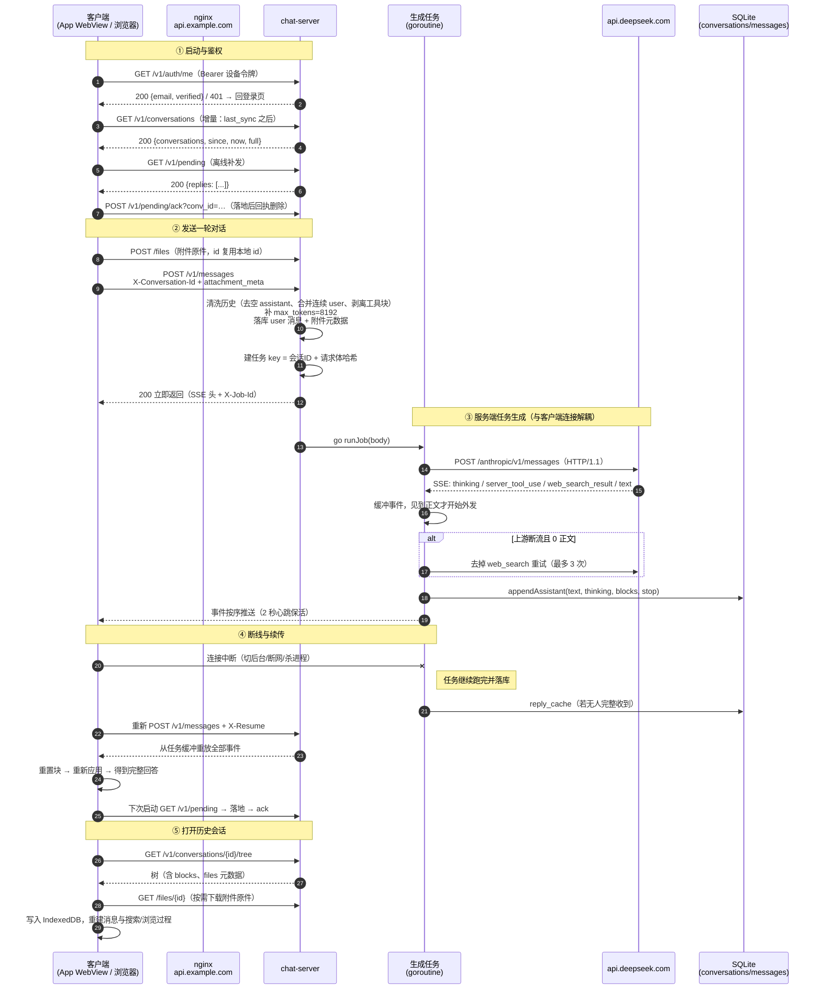

# 对话流程（时序图）

> 部署结构：客户端 → `api.example.com` → nginx → chat-server → DeepSeek。
> 生成由**服务端任务**负责，客户端只是订阅者；断线可续传，未送达的回答进离线缓存。

## 关键约定

| 环节 | 设计 |
| --- | --- |
| 入口 | API 走 `api.example.com`（DNS-only + Let's Encrypt），静态页仍可走 `chat.example.com` |
| 生成 | 服务端任务持有完整事件流；客户端断开不影响生成与落库 |
| 重试 | 上游 0 正文断流时，任务内部去搜索重试 3 次，失败尝试不外发 |
| 续传 | 同一任务可被 `X-Resume` 重放；未送达则进 `reply_cache`，由 `/v1/pending` 补发 |
| 同步 | `client_tokens.last_sync` 记录每设备同步点，只下发其后更新的会话 |
| 正文 | 只同步列表，正文与附件在打开会话时按需拉取 |
| 消息 | `text` / `thinking` / `blocks`（工具过程）/ `files`（附件元数据）分列存储 |
